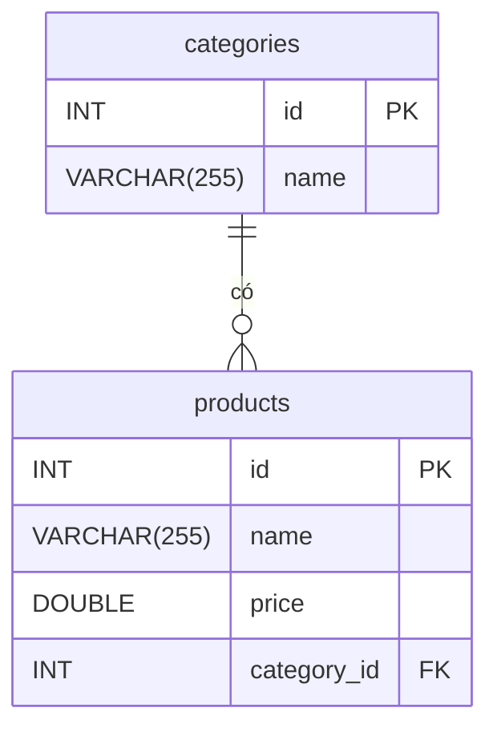

# [Bài tập] Thao tác dữ liệu với SQL – products & categories

## 1. Mục tiêu
- Thực hành INSERT, UPDATE, DELETE, SELECT
- Hiển thị dữ liệu có sắp xếp (ORDER BY)
- Dùng GROUP BY để thống kê số lượng sản phẩm theo danh mục

## 2. Thiết kế CSDL



Script: [`scripts/products.sql`](scripts/products.sql). Mở trong MySQL Workbench rồi chạy toàn bộ (Ctrl+Shift+Enter).

## 3. Các câu lệnh chính

```sql
-- 1. Thêm 3 sản phẩm mới
INSERT INTO products (name, price, category_id) VALUES
('Xiaomi Redmi Note 13', 4990000, 1),
('Chuột không dây Logitech', 350000, 3),
('iPad Gen 10', 9990000, 4);

-- 2. Cập nhật giá một sản phẩm
UPDATE products SET price = 20990000 WHERE id = 1;

-- 3. Xóa một sản phẩm
DELETE FROM products WHERE id = 5;

-- 4. Hiển thị tất cả sản phẩm, giá giảm dần
SELECT p.id, p.name, p.price, c.name AS category_name
FROM products p
LEFT JOIN categories c ON c.id = p.category_id
ORDER BY p.price DESC;

-- 5. Thống kê số lượng sản phẩm theo danh mục
SELECT c.id, c.name AS category_name, COUNT(p.id) AS product_count
FROM categories c
LEFT JOIN products p ON p.category_id = c.id
GROUP BY c.id, c.name
ORDER BY c.id;
```

## 4. Kết quả

**Sản phẩm sắp xếp giảm dần theo giá** (sau khi thêm, sửa, xóa):

| id | name                     | price    | category_name |
|----|--------------------------|----------|---------------|
| 4  | MacBook Air M2           | 24990000 | Laptop        |
| 1  | iPhone 15                | 20990000 | Điện thoại    |
| 2  | Samsung Galaxy S24       | 19990000 | Điện thoại    |
| 3  | Dell Inspiron 15         | 15490000 | Laptop        |
| 8  | iPad Gen 10              | 9990000  | Máy tính bảng |
| 6  | Xiaomi Redmi Note 13     | 4990000  | Điện thoại    |
| 7  | Chuột không dây Logitech | 350000   | Phụ kiện      |

**Số lượng sản phẩm theo danh mục:**

| id | category_name | product_count |
|----|---------------|---------------|
| 1  | Điện thoại    | 3             |
| 2  | Laptop        | 2             |
| 3  | Phụ kiện      | 1             |
| 4  | Máy tính bảng | 1             |

> Dùng `LEFT JOIN` để danh mục chưa có sản phẩm nào vẫn hiện ra với số lượng 0.
