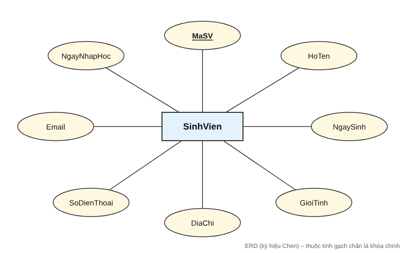
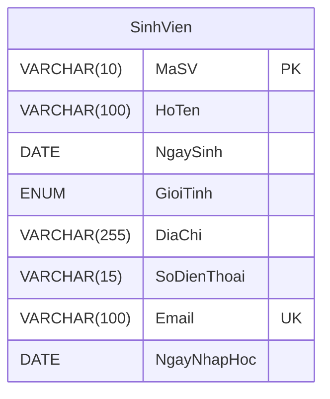

# [Bài tập] Quản lý sinh viên – Thực thể SinhVien (MySQL Workbench)

## 1. Thực thể (Entity)

**SinhVien**: đối tượng nhà trường cần lưu trữ và quản lý.

## 2. Thuộc tính (Attributes)

| Thuộc tính   | Ý nghĩa         | Kiểu dữ liệu (MySQL)      | Ràng buộc          |
|--------------|-----------------|---------------------------|--------------------|
| **MaSV**     | Mã sinh viên    | VARCHAR(10)               | **Khóa chính (PK)** |
| HoTen        | Tên sinh viên   | VARCHAR(100)              | NOT NULL           |
| NgaySinh     | Ngày sinh       | DATE                      | NOT NULL           |
| GioiTinh     | Giới tính       | ENUM('Nam','Nu','Khac')   |                    |
| DiaChi       | Địa chỉ         | VARCHAR(255)              |                    |
| SoDienThoai  | Số điện thoại   | VARCHAR(15)               |                    |
| Email        | Email           | VARCHAR(100)              | UNIQUE             |
| NgayNhapHoc  | Ngày nhập học   | DATE                      |                    |

## 3. Sơ đồ ERD

Ký hiệu Chen (hình chữ nhật = thực thể, hình elip = thuộc tính, gạch chân = khóa chính):

Dạng bảng (như MySQL Workbench hiển thị):

## 4. Cách làm trong MySQL Workbench

1. Mở MySQL Workbench và kết nối tới MySQL Server (Local instance).
2. **File → Open SQL Script…** rồi chọn `sinhvien.sql`.
3. Bấm biểu tượng ⚡ (Execute) để tạo database `QuanLySinhVien`, bảng `SinhVien` và dữ liệu mẫu.
4. Vẽ ERD tự động: **Database → Reverse Engineer…** → chọn kết nối → chọn schema `QuanLySinhVien` → Next đến hết → Finish.
   Workbench sẽ sinh sơ đồ EER có bảng `SinhVien` (biểu tượng chìa khóa vàng là khóa chính `MaSV`).
5. Lưu mô hình: **File → Save Model As…** → `sinhvien.mwb`; xuất ảnh: **File → Export → Export as PNG…**.
6. Đưa các file lên GitHub và nộp link repository.

## 5. File trong thư mục

- `sinhvien.sql` – script tạo database, bảng và dữ liệu mẫu
- `erd-sinhvien.svg`, `erd-sinhvien.png` – sơ đồ ERD thực thể SinhVien
